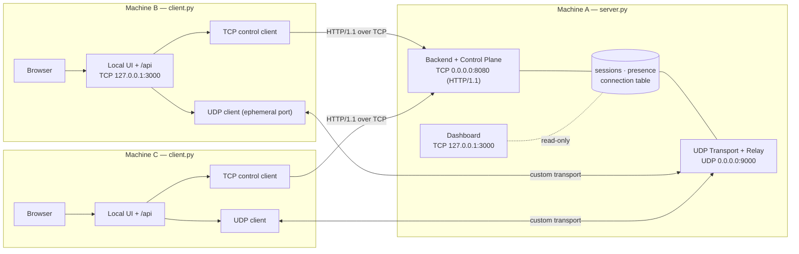
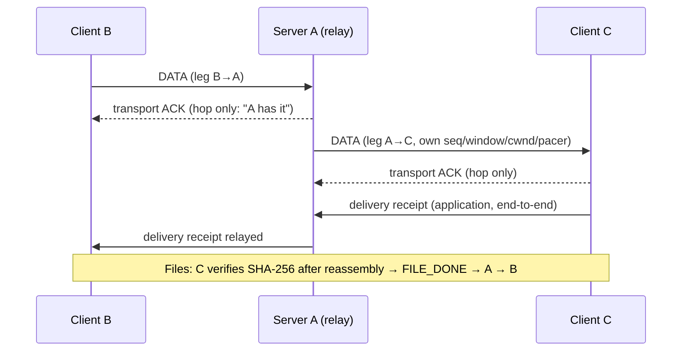
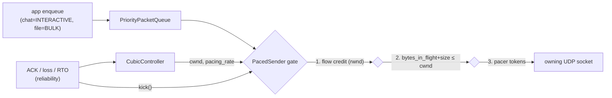

# Architecture

**Reference:** `MMT_Assignment_Architecture_and_Transport_Design.md` (ARCH). This file describes how ARCH maps onto the codebase. Decisions are tracked in [DECISIONS.md](DECISIONS.md).

## 1. Two process roles

| Process | Entry point | Runs on | Services (threads inside the one process) |
|---|---|---|---|
| Server | `server.py` → `ServerApplication` | Machine A | Control plane (TCP 8080), UDP transport + relay (UDP 9000), dashboard (TCP 3000) |
| Client | `client.py` → `ClientApplication` | Each of B, C, … | UDP client → A:9000, TCP control client → A:8080, local UI + API (TCP 127.0.0.1:3000) |

There is no third process. The client process **is** the native agent behind the browser UI, because a browser cannot open raw UDP sockets.

## 2. Package map and separation of concerns

The PDF §7 requires network logic, data processing and the UI to be separate.

| Layer | Packages | Must not |
|---|---|---|
| UI | `src/*/frontend/static/` (HTML/CSS/vanilla JS) | Touch transport state; open sockets other than same-origin HTTP |
| UI bridge | `src/client/frontend/{http_server,local_api,event_hub}.py`, `src/server/frontend/http_server.py` | Implement transport algorithms |
| Data processing / routing | `src/server/backend/*`, `src/server/udp/{relay,connection_manager}.py`, `src/client/{tcp,udp}/*` | Call `sendto()` directly; all sends go through the scheduler |
| Network / transport | `src/transport/*` (shared), `src/common/http/*` (shared) | Import `src.server` or `src.client`; know about users, chats or files |
| Common | `src/common/{constants,config,lifecycle,exceptions,logging_config}.py`, `src/common/protocol/*` | Open sockets or start threads at import time |

There is one implementation of each transport mechanism (`src/transport/`). The server and client create **instances** of it, one per connection and direction.

## 3. Ports and binds

| Service | Default bind | Port | Constant |
|---|---|---:|---|
| Dashboard | `127.0.0.1` (`--ui-bind` to expose) | 3000 | `DEFAULT_SERVER_UI_BIND`, `SERVER_UI_PORT` |
| Control plane | `0.0.0.0` (`--bind`) | 8080 | `DEFAULT_SERVER_NETWORK_BIND`, `CONTROL_TCP_PORT` |
| UDP transport | `0.0.0.0` (`--bind`) | 9000 | `DEFAULT_SERVER_NETWORK_BIND`, `UDP_TRANSPORT_PORT` |
| Client UI + API | `127.0.0.1` | 3000 | `DEFAULT_CLIENT_UI_BIND`, `CLIENT_UI_PORT` |

**Validation** (`src/common/config.py`):

- Ports must be in 1–65535.
- The client destination must be unicast IPv4. `0.0.0.0`, broadcast and multicast are rejected; loopback is allowed.
- A TCP collision between the dashboard and the control plane is rejected when their binds overlap.
- UDP and TCP port spaces are independent.

## 4. TCP control plane (D1: HTTP/1.1, one listener)

- **One** `RawHttpListener` on 8080 (`ControlServer`). `ControlRequestHandler` maps `ControlOperation`s to endpoints, which are defined in Phase 3.
- The client's `TcpControlClient` uses `RawHttpClient`, which speaks the same protocol.
- **Responsibilities:**
  - the application handshake + ACK (rubric Step 2);
  - login (Step 3), with the server tracking each user's IP and ports;
  - sessions, presence and the user list;
  - file offer/accept/reject/done metadata;
  - binding an authenticated session to its UDP endpoint.
- Presence push is D2.

## 5. UDP data plane and relay (D3, D14)

- **Each leg has its own transport state, per direction:** reliability, flow control, CUBIC, pacer and queue.
- **Identity:** connection ID plus the endpoint registered through the authenticated control plane. A username written in a payload never counts as identity.
- **Bounded relay queues:** if leg A→C is slow, A reduces the credit it advertises on B→A, so a slow client does not stall the others.
- **File-transfer flow (ARCH §6.4):**
  1. The offer and metadata (name, size, SHA-256) travel over TCP.
  2. C accepts over TCP.
  3. The chunks travel over UDP via A. A never holds the whole file in memory.
  4. C verifies the SHA-256 and sends `FILE_DONE` back to B over TCP.

## 6. Transport internals (send path)

- **Existing, copied unchanged:** `CubicController`, `Pacer`, `PacedSender`.
- **Stubs gated on D14:** reliability and flow control.
- **Scaffold:** the scheduler and `ThreadTimerHost`.

## 7. Threading model (D11)

| Process | Thread | Owns |
|---|---|---|
| Both | **Transport scheduler** (`ThreadTimerHost`) | All transport state: PacedSender, CUBIC, Pacer, reliability, flow, timers |
| Server | Dashboard accept thread + bounded worker pool | Dashboard HTTP connections |
| Server | Control accept thread + bounded worker pool | Control HTTP connections; session/presence managers (lock-protected) |
| Server | UDP receive thread | Socket reads only; `post()`s each datagram to the scheduler |
| Client | UI accept thread + bounded worker pool | Local HTTP; `post()`s commands; reads the EventHub |
| Client | TCP control-client thread | Control requests and presence |
| Client | UDP receive thread | Socket reads; `post()` to the scheduler |

**Rules:**

- No thread per packet.
- No busy-waiting: timers use `Condition.wait(timeout)`.
- Queues are bounded.
- Every socket is created in `start()`, never at import or in `__init__`.

## 8. Lifecycle, partial failure and cleanup

`ServiceGroup` (`src/common/lifecycle.py`) handles startup and shutdown:

- **Start order:**
  - server: control → UDP → dashboard;
  - client: UDP → TCP → UI.
- **On a start failure:**
  1. The failing service's `stop()` runs.
  2. The already-started services are stopped in reverse order.
  3. The process exits non-zero.
- `stop()` is idempotent, and Ctrl+C triggers `shutdown()`.
- **Scaffold:** `start()` raises `NotImplementedError`, so `run()` returns exit code 2 with a clear message.

## 9. Frontends

| | Server dashboard | Client UI |
|---|---|---|
| Location | `src/server/frontend/static/` | `src/client/frontend/static/` |
| Purpose | Monitoring: service status, LAN info, sessions, per-leg transport stats | Using the app: login, users, global/direct chat, file transfer with progress, notifications |
| Data source | Read-only dashboard endpoints (Phase 10) | Same-origin `/api/*` + events (D2) on the same listener |
| Scaffold state | Labeled placeholders; no requests | Disabled controls; tab switching only; no requests |
